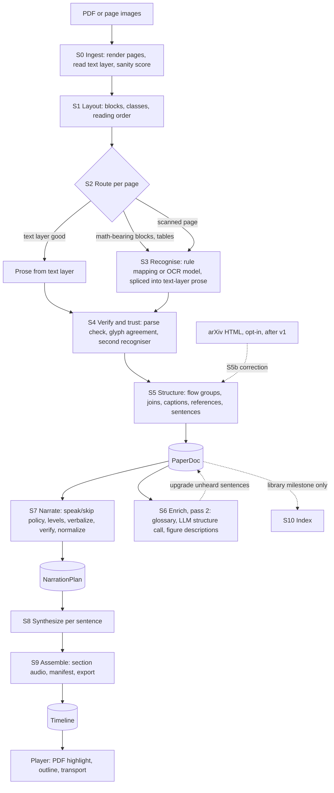

# PodPaper rebuild plan

## Summary

- Rebuild PodPaper from an empty repo as a local, offline web app for macOS on Apple silicon: PDF in, interactive audiobook out, with the 2020 player and listening options.
- v1 is pretrained local models, deterministic checks, and one owned PyTorch model (MathSpan, the inline-math tagger). Three more owned models follow (verbalizer, DocStruct, TrustGate). Each starts only on a measured trigger and becomes the default only if it beats a measured baseline.
- Born-digital prose always comes from the PDF text layer. An optical character recognition (OCR) model supplies only math spans, tables and scanned pages, and its output is spliced into the text-layer prose.
- Wrong math spoken confidently is the worst failure for an eyes-closed listener. Every math span, inline and display, carries a trust signal; low-trust math is announced, never guessed; the rate of wrong-and-unflagged spoken math is a v1 gate.
- Conversion runs in two passes: a provisional rule-based pass that is playable within minutes, then a background upgrade pass that adds language-model readings and descriptions to sentences not yet heard.
- An arXiv PDF + HTML pairing engine supplies training labels and part of the gold data. A fully hand-verified subset keeps the evaluation independent of that engine.
- A vector database (LanceDB) appears only in a late library milestone, and only if it beats keyword search and brute-force search on our own retrieval set. Otherwise the project ships without one.
- Nothing has been installed or run on the M3 Max; names, versions and licences were checked against registries and model cards only. Every throughput figure, "runs on MPS" statement and numeric gate is a planning assumption until measured. Rough size: 14 to 16 focused weeks to v1, 22 to 26 to the end of the plan.

## Goals and non-goals

**Goals (the old service contract, kept)**

- Input: a PDF of a scientific article or textbook chapter. PNG/JPG page images are accepted, wrapped into a PDF at ingest and treated as scanned.
- One global reading order of typed elements (text blocks, figures and tables with captions, display equations), numbered by type ("Paragraph 2", "Figure 1").
- Math spoken as English, inline and display, with the LaTeX kept beside it. Figures spoken through caption or description, with the crop kept for display.
- One continuous track with start times per element and sentence.
- Player: PDF on the left with the current element highlighted, element outline on the right. The 2020 controls are kept: play/pause, back 5 s, forward 5 s, previous and next element, progress bar, outline with now-playing marker, continuous vs pause-after-element (with the spoken "continue?" prompt), read/skip figure descriptions, pause at figure reference, user stylesheet.
- New controls: speed, previous and next sentence, keyboard shortcuts, hardware media keys through the browser Media Session API, screen-reader labels, a layout that works down to tablet width.
- Flow: upload (with a page-range or PDF-outline chapter picker), loading screen with live status, player. Local web app on port 8090, `POST /convert` kept as an alias, offline after model download.

**Goals (the old failures, fixed)**

- Math recognition that works; verbalization that never crashes and never speaks raw LaTeX.
- A typed JSON document instead of pseudo-LaTeX strings, with a written speak/skip policy for every element kind (matrix below).
- Resumable jobs, caching, tests, and an evaluation harness with gold sets.

**Dropped or changed from 2020**

- The "full LaTeX document" intermediate is replaced by the JSON document; a Markdown and LaTeX exporter is kept as a cheap output.
- Ubuntu and Windows support is dropped for now. Training scripts stay device-agnostic.
- Handwritten equations and the companion "PDF of all figures" are dropped; figures are shown in the player.
- Whole books are deferred to M10. Until then a job is capped at about 60 pages with a clear message. Encrypted, corrupt and non-English PDFs are rejected with a stated reason.

**Non-goals for v1**

- Voice cloning, non-English narration (Kokoro's word timestamps are English only), hosted multi-user service, native or mobile app, two-host podcast summaries.
- Deferred, not rejected: table summaries, arXiv correction, extra listening profiles, spoken answers, earcons, sleep timer, section summaries, a Tauri 2 wrapper.

## Architecture overview

Four runtime pieces, no Docker and no workflow engine:

1. **API server** (FastAPI + uvicorn): upload, job progress over server-sent events (SSE), artifacts, audio with HTTP Range, the built single-page app.
2. **One worker process** that owns the PyTorch models and runs the stages. PyTorch uses MPS (Metal Performance Shaders, its Apple GPU backend). The worker is separate from the API so a model crash cannot kill the server.
3. **Ollama** as the local server for the large language model (LLM) and, if the bake-off picks it, the OCR vision-language models (VLMs). One thin client hides it. Context size is fixed per use in an Ollama Modelfile, because the OpenAI-compatible endpoint cannot set it per request. The client refuses any prompt whose token count exceeds the configured context, so truncation cannot happen silently (truncation behaviour: verify).
4. **A Node batch CLI** wrapping MathJax and the Speech Rule Engine (SRE) for LaTeX to MathML to rule-based speech.

Orchestration is our own code, about 300 to 500 lines: a content-addressed blob store plus SQLite. A stage unit is done if and only if its cache key exists; the key hashes stage name, version, model revision, parameters and input hashes. Granularity is page for layout, region for recognition, element for narration, sentence for speech. The same code runs from the CLI (`podpaper convert`, `podpaper stage`, `podpaper inspect`) without the server. DBOS is the upgrade path if retries or several workers are ever needed.

**Two passes.** Structure, the glossary and LLM readings need the whole document, so they cannot sit in front of first audio.

- Pass 1 (provisional): S0 to S2 run over all pages (fast), rule-based structure follows, then recognition, SRE rule readings and synthesis run in reading order. The first section is playable as soon as it is synthesized.
- Pass 2 (upgrade): glossary, the LLM structure call, natural readings and figure descriptions. Changed sentences are re-narrated and their section segments rebuilt. The player swaps a segment only at a section the listener has not reached. The per-sentence cache and the element-based playhead make this cheap.



## Document IR

The intermediate representation (IR) is three JSON artifacts per document, all pydantic v2 models with a `schema_version`. They are separate because the listener changes how things are read without the document changing.

| Artifact | Answers | Key contents |
|---|---|---|
| **PaperDoc** | What is on the page | Pages; elements in global reading order; flow groups; section tree; math objects; bibliography; symbol glossary; pronunciation lexicon |
| **NarrationPlan** | What is said | Utterances per sentence, with level, spoken text, a map from spoken characters back to source spans, pause, and verifier result |
| **Timeline** | When it is said | Per-section audio segments; per-utterance start and end; word times; reference events; chapters |

```
Element   {id "e0042", kind, order, flow_id, continues_from?, display_no, label?, section_id,
           prov[{page, bbox in PDF points}],            # more than one box = spans pages
           sentences[{id, spans[Span]}] | math_id | table_html | image_blob,
           caption_id?/target_id?, skip_group?,          # proof, references, footnote, appendix, acknowledgements
           confidence{layout, recog, agreement?, trust}, source: textlayer|rule|vlm|html|llm}
kind      title | authors | abstract | heading | paragraph | list_item | display_math | figure |
          table | caption | algorithm | code | theorem | proof | footnote | reference_entry | furniture
Span      Text | MathRef{math_id} | DisplayMathRef{element_id} | Cite{bib_ids} |
          XRef{target_element_id} | FootnoteMark | Link
Math      {id, display, tex, tex_norm, mathml, alt_tex[],   # alt = rule mapping or second recogniser
           number?, stats{nodes, depth, has_2d, n_lines}, leaves[], confidence}
Utterance {id, element_id, sentence_id?, kind, level L0..L4, spoken, src_map[],
           pause_after_ms, alt_of?, verify{check, passed, fallback, engine}}
```

Design consequences:

- **Flow groups.** "We obtain [display equation] where x is ..." is one sentence across three elements. Elements that share a `flow_id` form one logical paragraph; a sentence's spans may contain a `DisplayMathRef`. Paragraph numbering, pause-after-element and sentence splitting work on the flow group, so a pause never lands mid-sentence.
- **Stable sentence IDs.** S5 splits sentences and writes them into PaperDoc. S7 only maps sentences to utterances.
- The playhead is stored as `(element_id, sentence_id, fraction)`, never as seconds, so a re-render, an upgrade pass or a different voice keeps the listener's place.
- Every listening option is a player-side decision over `kind`, `skip_group` and events. Changing an option never re-synthesizes audio.
- `Math.leaves` is the multiset of identifiers, numbers and operators from the semantic tree. The verifier and the trust checks both use it.
- All geometry is in PDF points, including for image input.
- We own the schema (it needs speech, verification and audio fields no existing schema has) and borrow the provenance idea from Docling's `DoclingDocument`. Importers from Docling and MinerU output exist for the bake-off and for the adopt path in M3.

## Pipeline stages

| Stage | What it does | Model / tool | Ours vs pretrained | Runs on |
|---|---|---|---|---|
| S0 Ingest | `doc_id = sha256(pdf)`; wrap images into a PDF; render pages at about 200 dpi; read glyph runs (character, font, size, box) with ligature expansion, glyph-name mapping and space reconstruction; compute a text-layer sanity score (dictionary hit rate of extracted words, share of private-use or control code points); detect an arXiv ID; reject encrypted, corrupt or non-English input | pypdfium2 (BSD-3-Clause/Apache-2.0). PyMuPDF excluded (AGPL, a copyleft licence) | Tool plus rules | CPU |
| S1 Layout | Boxes, 25 classes and reading order per page (reading order from the transformers port: verify); drop repeated headers and footers by position and string repeat | PP-DocLayoutV3 via transformers, inference only | Pretrained | PyTorch/MPS (operator coverage: verify), CPU fallback |
| S2 Route | Per page: `text_layer`, `text_layer+math`, `full_ocr`, or `escalate` | Hand thresholds on the sanity score, text-layer coverage and math-font fraction | Rules, ours | CPU |
| S3 Recognise | Prose from the text layer. Short inline spans are mapped by rule (glyph name and font to LaTeX, baseline shift to sub/superscript). Other math-bearing blocks are cropped to the OCR model; its output is aligned to the text layer and spliced, keeping text-layer characters outside `$...$` and taking only the math spans from the model. Formula and table crops give LaTeX and HTML. Scanned pages take full OCR. Algorithms and code are kept as plain text for display. Figures are cropped only. From M4, MathSpan tags the spans, line-wrapped spans are merged, and only spans above a complexity threshold are cropped | Primary recogniser and runner fixed by the M3 bake-off; MathSpan | Pretrained; rules and MathSpan ours | Bake-off runner (Ollama, llama.cpp or transformers/MPS); MathSpan on PyTorch/MPS |
| S4 Verify and trust | MathJax parse check. Glyph-leaf agreement: letters and digits in the PDF glyph run must match the leaves of the recognised LaTeX. A second recogniser re-reads display crops and any span that fails a check. Agreement between two readings is equality, or tree edit distance under a threshold, of canonicalised MathML from MathJax, never a LaTeX string comparison. Poor splice alignment flags the paragraph | MathJax 4; second recogniser; rule policy, later TrustGate | Rules and pretrained; TrustGate ours | Node, recogniser runner, PyTorch |
| S5 Structure | Pass 1 rules: flow groups, cross-page joins, caption links, equation numbers, cross-reference and citation regexes, bibliography split, heading levels from font size and numbering, math-safe sentence split. Pass 2: one schema-constrained LLM call over heading and first-page blocks for title, authors and heading levels. Later DocStruct | Rules; Qwen3.8-27B; DocStruct | Rules and pretrained; DocStruct ours | CPU, Ollama, PyTorch/MPS |
| S5b arXiv correction (after v1) | If enabled and an arXiv ID resolves, align arXiv HTML blocks to elements and replace formula LaTeX and prose. Geometry always comes from S1 | Our HTML parser and aligner | Ours (code, no model) | CPU, network |
| S6 Enrich (pass 2) | Symbol glossary built from definition-bearing sentences found by rules ("let x be", "where x denotes"); figure descriptions | Qwen3.8-27B (vision), JSON-schema output | Pretrained | Ollama |
| S7 Narrate | Apply the speak/skip matrix; map sentences to utterances; pick a level by complexity; verbalize math; run the per-level verifier; normalize numbers, units and abbreviations; apply pronunciation overrides | MathJax 4 and SRE for rule readings; Qwen3.8-27B zero-shot for display and complex inline math, later our verbalizer; num2words; misaki overrides | Rules, pretrained, then ours | Node CLI, Ollama, PyTorch/MPS |
| S8 Synthesize | One sentence at a time, split at clause boundaries below the engine's phoneme limit. Cumulative sample counts give offsets. Engine word times are mapped back to spoken characters by a token-to-character alignment step. Silence by element kind, at least 150 ms at every element boundary | Engine fixed by the M3 speech bake-off; Kokoro-82M v1.0 is the default candidate | Pretrained | PyTorch; MPS needs `PYTORCH_ENABLE_MPS_FALLBACK=1`, CPU may be as fast (measure) |
| S9 Assemble | One M4A (AAC audio) segment per section; offsets re-measured on the decoded segment; fixed gain per voice, measured once; manifest; chaptered M4B/MP3 export; Markdown/LaTeX export of PaperDoc | ffmpeg | Tool | CPU |
| S10 Index | Chunk and embed elements (library milestone only) | embeddinggemma-2, text-only configuration | Pretrained | PyTorch/MPS, float32 |

**Speak/skip matrix (v1 defaults).** This is an M1 deliverable with a golden-file narration test per kind.

| Kind | Default | Option |
|---|---|---|
| Title, abstract, headings, paragraphs, list items | Read | n/a |
| Authors | Names read; affiliations, emails skipped | Skip authors |
| Numeric citation "[12]" | Silent | Read as "reference twelve" |
| Author-year citation | Read as written, page numbers dropped | Silent |
| Cross-reference ("Fig. 3", "Eq. (4)") | Read as "Figure 3"; emits a reference event | Pause at reference |
| Footnote | Read at the end of its paragraph, prefixed "Footnote" | Skip |
| Display equation | Read by the level policy, then its number | Literal re-read on demand |
| Figure | "Figure N", caption verbatim | Add generated description |
| Table | "Table N", caption, row and column count; body shown on screen, not read | n/a in v1 |
| Algorithm, code | Announced with title and line count; body shown, not read | n/a in v1 |
| Theorem, proof | Read with label ("Theorem 2") | Skip proofs |
| URL, email | Spoken as "link" with the domain | n/a |
| Acknowledgements, reference list | Skipped; reference list announced with its count | Read |
| Appendix | Read | Skip |
| Page furniture, equation-number-only blocks | Never read | n/a |

**Trust policy from v1.**

- Low-trust display math is announced ("an equation is shown here that could not be read reliably"), highlighted, and not read.
- A low-trust inline span is spoken as "an expression" and highlighted; the rest of the sentence is read normally.
- A paragraph whose splice alignment is poor is read from the text layer with its math spans treated as low-trust.

**Audio delivery.** Speech is cached per sentence and concatenated into one segment per section. Skips are client-side seeks over manifest ranges. AAC priming and coarse `timeupdate` events make browser time less exact than PCM (uncompressed audio) sample counts. M2 therefore chooses between `<audio>` elements polled every animation frame (the default, with the 150 ms boundary pad) and Media Source Extensions with fragmented MP4. Both keep pitch-preserving speed control. Each display equation also gets a pre-rendered literal reading as a separate clip.

## ML modeling plan

### Data engine (built in two steps, feeds everything)

- **Corpus:** arXiv papers from 2024 onward (native HTML exists only from about December 2023), licensed CC-BY (Creative Commons Attribution) or CC0 per arXiv metadata, stratified across fields. A thin slice of about 400 papers is built in M4; the full 3,000 follow in M7. Each paper is recorded in an attribution manifest.
- **Fetch budget:** arXiv's robots.txt sets a 15-second crawl delay, so two fetches per paper cost about 3 hours for the slice and about a day for the full corpus. The 10 papers for the first gold set are fetched by hand so the harness does not wait on the terms check.
- **Fallback if the terms or markup check fails:** arXiv's requester-pays bulk data with LaTeXML run locally (adds a Perl and TeX dependency: verify), or an existing source-derived corpus such as unarXive (verify).
- **Pairing without compiling TeX:** keep the PDF and its arXiv HTML. About 75% of papers convert without errors (arXiv:2605.16562). Parse the HTML into a geometry-free reference PaperDoc. The exact markup is unconfirmed (verify in M0).
- **Label transfer in two levels:** assign reference blocks to our blocks by text similarity with a matching solver (non-monotone, because floats, footnotes and column breaks move), then align monotonically inside matched blocks. Pages with coverage under 0.9 are dropped, and the drop rate is reported by page type so a bias against float-heavy pages is visible.
- **Compute split by what each dataset needs:**

| Dataset | Needs | Cost |
|---|---|---|
| Glyph runs tagged math / not math (MathSpan) | S0 and S1 plus glyph runs | Hours, CPU plus layout |
| Blocks with role, continuation and link labels (DocStruct) | S0 and S1 | Same pass |
| Equation pool with context and exact TeX (verbalizer) | HTML only | CPU |
| "Was the recognition wrong" labels (TrustGate) | S3 and S4 on a 20k to 50k equation sample; label is a canonical-MathML mismatch against truth, validated by CDM on a sample | About 1.5 to 4 days of GPU time (estimate; recomputed from the M0 regions-per-second figure before M7 starts) |

- **Quality gate:** a label-inspector page overlays transferred labels on pages. Audit 300 random pages and require at least 95% correct before any training.
- **Splits:** by paper, with one field held out. Training data is de-duplicated against all gold sets by normalised-TeX hash. Every run records the dataset manifest hash.
- **Flywheel:** verifier failures, recogniser disagreements and a player "read wrong" button log corrections. Data from the user's own documents stays local: it is excluded from Hub backups and rented-GPU jobs unless the document is tagged open-licence.

### Models

Ship rule for all four: the model replaces the baseline in the default pipeline only if it meets its gate with no regression elsewhere; otherwise it stays behind a flag with a written gap analysis. All targets are re-set from measured baselines in M3.

**1. MathSpan (committed, in v1): inline-math tagger over PDF glyph runs**

| Item | Plan |
|---|---|
| Purpose | Mark inline-math spans in born-digital text lines so only those spans go to the rule mapper or the formula recogniser. In v1 without it, whole math-bearing paragraphs go to the OCR model and are spliced; MathSpan makes that faster and more exact. Inline math was the weakest point in the toolkits surveyed (verify on G1 in M3) |
| Base | From scratch: 4-layer Transformer encoder, width 256, about 5M parameters, begin/inside/outside tags per glyph run. Features: unicode block, relative size, baseline shift, italic flag, width, gap, and a hashed font name with dropout so the model does not depend on TeX font names |
| Data | Glyph-tag dataset from the 400-paper slice (hundreds of thousands of lines), later the full corpus; class-weighted cross-entropy |
| Baselines to beat | Math-font heuristic; OCR-model paragraph recognition with splice; the layout model's inline-formula boxes, if PP-DocLayoutV3 has that class (verify) |
| Gates | Span F1 at least 0.95 on G1. Downstream inline CDM (character detection matching, the standard rendered-formula metric) at least 0.92. Prose character error rate at most 0.5% on routed pages. On the G2 non-LaTeX pages it must not be worse than the heuristic; if it is, it is enabled only when TeX fonts are detected |
| Trains on | MPS, expected under an hour per run (verify); CPU parity test on a tiny batch |

**2. Verbalizer (starts on a trigger): LaTeX plus context to spoken English**

| Item | Plan |
|---|---|
| Purpose | Natural reading of the 100 to 1,000 math spans in a paper at far lower latency than the 27B model, with a fixed style |
| Start trigger (measured at v1) | The zero-shot 27B path misses the first-section or full-render speed gate, or its fallback rate exceeds 5%, or its hallucination bound exceeds 3%. If none fires, this budget goes to whichever stage is measurably weakest (DocStruct, TrustGate or the layout fine-tune) |
| Base | Qwen3.5-0.8B-Base, full fine-tune with HF (Hugging Face) Trainer. Anything larger (Qwen3.5-2B-Base) uses LoRA (low-rank adaptation) or a rented GPU, because mixed precision is not available on MPS |
| Input | Level tag, inline/display tag, left and right context with a math placeholder, glossary rows for the symbols present, the LaTeX, and the SRE rule reading. Supplying the rule reading makes this constrained rewriting, not open generation |
| Data | 30k pairs is the plan of record; 150k is a stretch. Equation pool from the data engine and MathBridge's equation and context columns (MIT; its spoken column is discarded; provenance: verify). Natural and gist targets distilled from Qwen3.8-27B: one candidate, one retry on verifier failure, with owner-written few-shot examples kept disjoint from G3. Filters: verifier, forbidden characters, and the Gemma 4 31B judge on a sample of about 2,000. Speech2Latex human-validated pronunciations (CC-BY-4.0, attributed). Literal readings are never trained: they always come from SRE |
| Teacher cost | 30k calls at an assumed 4 to 5 s is about 1.5 to 2 days of local GPU time; 150k is over a week locally or hours on a rented GPU with a batched server (estimates; the M0 spike measures calls per hour) |
| Inference | Greedy decoding with `\ $ ^ _ { }` banned and a length bound; verifier; one retry; then the SRE reading |
| Baselines | Raw SRE; zero-shot Qwen3.8-27B with verifier (also the teacher); Flan-T5-base with the missing LaTeX tokens added, trained on the same data |
| Gates (G3, n = 300, five structure strata of 60) | Crashes and residual LaTeX characters: 0. Verifier pass at least 97%. Hallucination: at most 3 of 300 (upper 95% bound about 2.6%). Non-inferior to the 27B: lower 95% bound of the judge win-or-tie rate at least 45%, faithfulness no worse. Wins against raw SRE on naturalness at least 65%. Better than the Flan-T5 ablation. In-pipeline fallback at most 5%. Full render of the 12-page reference paper within the post-M8 speed gate |
| Trains on | M3 Max MPS for the 0.8B model on 30k pairs (hours: verify from the 200-step spike); otherwise the same script on HF Jobs or Modal |

A distilled student is not expected to beat its teacher on quality. Its case is equal faithfulness at much lower latency, which is why it starts only if v1 latency or fallback is a measured problem.

**3. DocStruct (expected to start): document structure transformer**

| Item | Plan |
|---|---|
| Purpose | Heading levels, cross-page and cross-column continuation, flow groups, caption / footnote / equation-number attachment, furniture removal, and theorem / proof / algorithm roles |
| Base | From scratch: 6-layer Transformer over the document's block sequence, width 384, about 12M parameters. Per block: a frozen, cached granite-embedding-english-r2 embedding of the first 64 tokens, layout class, box, page index, font statistics. Heads: role and heading level, continuation, attachment pointer, successor pointer, keep/skip |
| Data | Structure labels transferred onto our own block predictions; summed multi-task cross-entropy. DocGenome (CC-BY-4.0) as an optional second source |
| Baseline to beat | PP-DocLayoutV3 reading order plus the S5 rules and LLM call |
| Start trigger | Starts unless the rules already meet every structure gate. This is expected to fire, so M9 is scheduled as committed work |
| Gates | On G1: heading-level accuracy at least 95%; caption-link F1 at least 0.97; continuation F1 at least 0.95; theorem/proof role F1 at least 0.90; at least 5 points over the rules baseline on section-tree similarity. On G2: no regression on heading levels and caption links, the only structure labels G2 carries |
| Trains on | MPS, expected hours because embeddings are cached (verify) |

In-text mentions ("Fig. 3", "Eq. (4)", "[12]") stay regex plus registry lookups; they are exact and need no model.

**4. TrustGate (starts on a trigger): error probability for recognised math**

| Item | Plan |
|---|---|
| Purpose | Turn the v1 flags into a measured statement about how many wrong equations, inline and display, are caught |
| Base | 3-layer multilayer perceptron with temperature calibration (Lightning Fabric loop). Features: parse success, MathML agreement distance, glyph-leaf agreement, splice coverage, sanity score, layout score, crop size, element kind |
| Data | The TrustGate label set from the data engine; binary cross-entropy |
| Baseline to beat | The v1 rule policy |
| Start trigger | The rule policy misses the trust or wrong-math-spoken gates at v1 |
| Gates | On a held-out slice with at least 500 wrong equations: catch at least 80% of wrong display equations and 70% of wrong inline spans while flagging at most 5% of correct ones, reported as a precision/recall point with a 95% interval. G1-H is a cross-check, not the gate, because it holds only a few dozen wrong equations |
| Trains on | MPS or CPU, minutes |

### Conditional and rejected

- **Layout detector fine-tune:** only if recall at 0.5 box overlap is under 0.95 for display formula, figure, caption or heading on the G1-H box labels. The base is Docling's heron detector (RT-DETRv2 architecture, Apache-2.0, trainable in transformers). The transformers port of PP-DocLayoutV3 raises an error when given labels, and its only training path is PaddlePaddle, which is outside the PyTorch requirement. Treated as a rented-GPU job.
- **Hard-scan fallback:** LightOnOCR-3-1B (or the 4B) as a page-level recogniser if scans defeat the small OCR models. Its transformers example runs on MPS in float32.
- **Not in the plan of record:** a learned router, a trained reverse verifier, a pause predictor, an OCR-model LoRA, and any from-scratch page or math OCR, which would land below the 97 to 98 formula CDM that pretrained models report on OmniDocBench v1.6 (vendor-reported).

## Local LLM/VLM usage

Rules for every call:

- Schema output validated by pydantic with one repair retry. Pydantic is the real guard; Ollama's schema enforcement with vision and thinking off has a bug history, so M0 pins Ollama at v0.40.17 or newer and tests the GGUF (llama.cpp weight format) and MLX (Apple's array framework) builds separately.
- Thinking is disabled with `reasoning_effort: "none"` on the OpenAI-compatible path. Temperature 0 is off the vendor's recommended sampling for Qwen3.8-27B, so every response passes a repetition check.
- One image per request. An open Ollama issue collapses two same-sized images into one for this model family.
- One Modelfile per use with a fixed context: 8K tokens for OCR and narration calls, 16K for structure and glossary, a measured larger size only for ask-the-paper.
- The LLM never rewrites prose. Prose gets deterministic normalization only.
- No LLM output reaches speech without the deterministic check for its kind and a rule fallback.
- Literal readings (L3 ClearSpeak style, L4 MathSpeak style) always come from SRE.

| Use | Model | Deterministic check |
|---|---|---|
| Region OCR (text, formula, table prompts) | Bake-off candidates: GLM-OCR, MiniCPM-OCR 1.0, PaddleOCR-VL-1.6 (GGUF), optionally OvisOCR3 (licence: verify). Primary and second opinion fixed in M3 | Splice alignment; MathJax parse; glyph-leaf agreement; MathML agreement |
| Title, authors, heading levels | Qwen3.8-27B over heading and first-page blocks | IDs must exist; fall back to rules if invalid |
| Symbol glossary | Qwen3.8-27B over rule-selected definition sentences | Each row cites a defining element that must contain the symbol |
| Natural reading (L2) | Qwen3.8-27B for display equations and inline spans above a complexity threshold; cached by normalised LaTeX, level and context flags | Leaf coverage with an explicit synonym table ("squared", "d x", implied multiplication); else SRE reading |
| Gist (L1) | Qwen3.8-27B | No symbol or number that is absent from the equation; length bound; else SRE reading |
| Figure description | Qwen3.8-27B (vision): crop, caption, referring paragraph | Every number and named entity must occur in the caption or referring paragraph, else caption only. Caption is read first; description announced as generated |
| Ask the paper (library milestone) | Qwen3.8-27B with IR text and element IDs | Cited IDs must exist; they resolve to playback positions |
| Distillation teacher | Qwen3.8-27B, offline | See the verbalizer |
| Judge | Gemma 4 31B-it, evaluation and data filtering only | Calibrated on about 200 owner labels; used only if agreement (kappa) is at least 0.6 |

The verifier is built in M1 against SRE output. Its false-reject rate is measured on 200 equations in M3 before any gate that depends on it is fixed.

Math level policy for the single v1 profile:

- Simple inline math (under the complexity threshold): the SRE ClearSpeak reading. This keeps hundreds of spans off the 27B model.
- Complex inline math and short display equations: natural reading (L2).
- Long or aligned blocks: a one-sentence gist (L1) plus L2 for the first and last lines.
- Matrices and large piecewise expressions: gist plus a shape description. A listener study measured synthesized matrices at 17 to 29% intelligibility (Roychowdhury et al., Interspeech 2025).
- Repeated equations: a back-reference instead of a re-read.

Memory is weights plus context cache, and the cache is the part that can surprise. Published weight sizes: Qwen3.8-27B 18 GB, Gemma 4 31B 20 GB (loaded only for judging), each OCR model 1 to 3 GB, speech and embedding models under 4 GB. On a machine this size Ollama defaults every model to a 256K context, which by calculation adds roughly 17 GB to the 27B model; the Modelfiles prevent that. Keep-alive and the maximum number of loaded models are pinned so the OCR model, the 27B and the judge do not evict each other. M0 records real figures with `ollama ps`.

## Vector database

The PDF-to-audio pipeline (S0 to S9) uses none. The owner asked for one where necessary, so necessity is tested rather than assumed. A single user's library is tens to hundreds of papers, about 10k to 50k chunks; at that size brute-force cosine similarity over an array answers in milliseconds.

**The test (M10).** Three arms on the G6 retrieval set: SQLite full-text search (FTS5) only; brute-force dense search; LanceDB hybrid (keyword plus dense). LanceDB (embedded, Apache-2.0, pinned to 0.41.x) is adopted only if hybrid beats FTS5 by at least 5 points of recall@5, or the library is large enough that brute force misses the latency gate. Otherwise the library ships on FTS5 plus brute-force dense search and the project has no vector database.

**What is indexed and why**

- One `chunks` table: one row per speakable element or merged run of about 200 to 400 tokens. Paragraphs embed their text with inline math in spoken form; display equations embed "Equation N: gist + reading"; figures embed caption plus description; tables embed their caption. Columns: `doc_id, element_ids, kind, section_path, page, order, text, vector(768)`, with a full-text index.
- One `docs` table: a title-plus-abstract vector per paper, for "similar papers".
- Reason 1: cross-paper library search ("which of my papers covers X, and where"). There is no key to look up.
- Reason 2: long documents ("jump to where they discuss X"). Full-context question answering on a local 27B model may take minutes of prompt evaluation for a long paper, so the cut-over from full context to retrieval is set from a measured answer-latency gate (planning value: first token within 20 s), not fixed in advance.
- Embedder: embeddinggemma-2 loaded in its text-only configuration (the full model is multimodal), float32 on MPS because float16 silently degrades, with its documented task prefixes and a NaN check in the index build. Compared once against Qwen3-Embedding-0.6B before locking. Qwen3-Reranker-0.6B is added only if recall@5 stays under 0.85.

**Properties**

- Derived and rebuildable from the PaperDoc files; never the source of truth.
- No timestamps are stored. A hit resolves `element_id` to a time through the current Timeline.
- Exit criterion: the core pipeline runs with LanceDB uninstalled.

**Deliberately not in a vector database**

| Item | Mechanism instead |
|---|---|
| Symbol glossary, acronyms | SQLite, exact normalised key. Fuzzy matching on symbols is harmful |
| Verbalization and speech caches | Exact hash of normalised LaTeX, level, context flags and model version. Semantic caching would conflate `x^2` and `x_2` |
| Citations and cross-references | Parsed bibliography and registry, resolved by key or number |
| Pronunciation lexicon | Dictionary plus a user overrides table |
| PDF de-duplication | sha256, then arXiv ID or DOI |
| Page furniture | Position and string repeat |
| Jobs, positions, stage cache | SQLite and content-addressed files |
| Page-image retrieval | Not built; we parse to text anyway |

## Tech stack

| Tool | Role | Why |
|---|---|---|
| uv, Python 3.12 | Environment, lockfile | Installs Python itself; the only Kokoro release needs Python below 3.13 |
| torch 2.15 (MPS), transformers 5.x | Framework for layout, speech, embeddings and all owned training | Required framework; device-agnostic scripts also run on rented CUDA. Kokoro 0.9.4 against these versions: verify |
| HF Trainer (+ PEFT if LoRA) | Verbalizer training | Standard path for a pretrained language model |
| Lightning Fabric | MathSpan, DocStruct, TrustGate loops | Explicit loops for owned architectures; easier to debug on MPS |
| Trackio | Experiment tracking | Local SQLite, no server |
| HF Hub private repos; HF Jobs or Modal | Dataset and weight backup; rented GPU for training or batched teacher generation | Same script runs remotely for tens of dollars |
| Ollama (v0.40.17 or newer) | Local server for Qwen3.8-27B, Gemma 4 31B and OCR candidates | One service. GLM-OCR is in the official library; MiniCPM-OCR 1.0 is a vendor upload needing a custom three-file Modelfile |
| llama.cpp server, `mlx-vlm` | Fallback runners | llama.cpp for MiniCPM-OCR and PaddleOCR-VL GGUF files; `mlx-vlm` for GLM-OCR only (no MLX port of MiniCPM-OCR was found) |
| PP-DocLayoutV3 | Layout and reading order | Front end of the leading OCR stacks; Apache-2.0; inference only in transformers |
| pypdfium2 | Rendering and text layer | Fast, permissive licence; glyph reads are batched for corpus work |
| MathJax 4, Speech Rule Engine (Node) | LaTeX to MathML, rule readings, semantic tree | Most robust TeX-math parser. MathJax 4 bundles an SRE 5 release candidate while standalone SRE is 4.1.5; M0 decides which engine owns speech and the semantic tree, and exact versions are pinned. MathCAT skipped: no macOS Python package |
| Kokoro-82M v1.0, misaki, num2words | Speech, pronunciation overrides, numbers | PyTorch, faster than real time, word timestamps, phoneme overrides. Confirmed or replaced by the M3 speech bake-off |
| ffmpeg, espeak-ng | Audio assembly and export; pronunciation fallback | Standard; installed with Homebrew (already present) |
| FastAPI, uvicorn, SSE | API and progress | One-way progress with reconnect replay over plain HTTP |
| SQLite (WAL mode, FTS5) + files | Jobs, events, positions, glossary, caches, keyword search | No daemon |
| React, Vite, react-pdf (pdfjs-dist), KaTeX | Player | Highlight overlay drawn from IR boxes, not the PDF text layer, so equations and figures highlight too |
| Playwright | One scripted end-to-end player test | Upload, play, seek and highlight checked without a person |
| LanceDB | Library index, if it wins the M10 test | Embedded, hybrid search, no server; pre-1.0, so pinned |
| pytest, ruff, ty, prek | Tests, lint, types, hooks | Fast single-binary tools; ty is pre-1.0 |
| pydantic-settings, typer | Config and CLI | The same models hash into cache keys |
| Whisper on PyTorch or MLX, jiwer | Speech round-trip check | Runs on the Apple GPU; math sentences are scored with a math-aware text normaliser |
| CDM scorer with TeX Live, ImageMagick, Ghostscript (dependency list: verify) | Offline formula metric only | Multi-GB install in its own environment; about a second per formula pair, so never on the runtime path |
| MinerU 4.2, Docling | Whole-pipeline references in the bake-off | Each in its own uv environment because they pin their own torch. Adopted as the front end only under the M3 rule |

## Repo layout

One Python package to start; split into a workspace only when training code grows.

```
PodPaper/
  pyproject.toml  uv.lock  .python-version  LICENSE  LICENSES.md  ATTRIBUTION.md
  podpaper/
    ir.py  settings.py  cache.py  jobs.py  llm.py  align.py  cli.py
    stages/    ingest.py layout.py route.py recognize.py splice.py trust.py structure.py
               arxiv.py enrich.py narrate.py tts.py assemble.py export.py index.py
    speech/    mathspeak.py (Node bridge) policy.py verify.py levels.py normalize.py lexicon.py
    models/    mathspan.py verbalizer.py docstruct.py trustgate.py   # nn.Modules + inference
    train/     data/ (corpus, pair, align, derive)  distill.py
               train_mathspan.py train_verbalizer.py train_docstruct.py train_trustgate.py
    server/    app.py routes.py sse.py worker.py
    node/      mathspeak.mjs package.json
  ollama/      # one Modelfile per use, with fixed context sizes
  web/         # Vite + React player; themes/ with a user stylesheet slot; fonts bundled locally
  evals/       # gold manifests (URLs for anything not redistributable), scorers, results/<git sha>.json, LEADERBOARD.md
  envs/        # separate uv environments: mineru/, docling/, cdm/
  tests/       # unit, golden-file per stage and per element kind, MPS-vs-CPU parity, player e2e, fixtures/legacy/
  docs/adr/    # one decision record per spike and bake-off
  data/        # gitignored: blobs/ docs/ corpus/ datasets/ runs/ feedback/ gold-private/ podpaper.sqlite lancedb/
```

`align.py` is shared by the v1 splice, the data engine and S5b. The old 193 MB git history is not carried over. Code mined from the old repo keeps its MIT notice and credits its nine commit authors in `ATTRIBUTION.md`.

Fixtures to copy from the old repo (a few MB): `resources/static_web_files/test.pdf`, root `latextext.txt`, `Image to Latex/Example Images/` with its `latextext.txt`, `testtext.PNG`, `TestFileConverted.mp3`. `TexToEnglish.py` is mined for test inputs, including the ones that crashed it. They come from https://github.com/ethan-godden/PodPaper at commit `b966a89`; see `tests/fixtures/legacy/README.md`.

## Evaluation and golden set

| Set | Contents | Ground truth | Built in |
|---|---|---|---|
| G0 legacy | Three independent checks, because the old fixtures are unrelated documents. (a) Pages of `test.pdf` (third-party lecture notes, Type 1 fonts with no unicode maps) as a crash, invariant and text-layer smoke input with a few hand-typed gold formulas. (b) Root `latextext.txt` (a lab report with no PDF in the repo) as verbalizer and speech input only. (c) The four old crops and `testtext.PNG` as formula and text recognition cases, with "must beat the old output" assertions (`±`, `f_0`, `10^{-4}`) | Hand-typed | M1 |
| G1 arXiv | 10 hand-fetched papers at M3, 30 by v1 (CC-BY/CC0; several fields; one- and two-column; at least one each with an algorithm block, a code listing, dense footnotes and a large table). Disjoint from training by paper and by TeX hash | Reference IR from arXiv HTML; every page reviewed in the label inspector; citation and reference text excluded from the prose metric | M3, M6 |
| G1-H | 5 of the G1 papers verified by hand on every page, including formula LaTeX, structure and boxes. At least 2 are papers whose HTML conversion failed, so the set is not limited to easy papers | Hand-verified, independent of the HTML parser | M3 |
| G2 off-distribution | 10 open-access non-arXiv journal PDFs, at least 5 not typeset with LaTeX; 5 scanned or textbook chapters; scan-degraded copies of G1 pages. Anything not redistributable stays in `data/gold-private/` with a URL manifest | Hand labels on 3 pages per document: text, formula LaTeX, heading levels, caption links, and glyph-level math spans on the non-LaTeX pages. Free truth for degraded copies | M3 |
| G3 verbalization | 300 owner-written items in five structure strata of 60 (inline symbol, fraction and script, sums and integrals, aligned and piecewise, matrix), spread over fields, with natural references | Human references | M5 |
| G4 audio | 200 sentences, half with math, plus a list of about 150 names, acronyms and symbols drawn from G1 | The script itself | M3 |
| G5 listening | 40 four-way formula-identification clips with near-miss distractors, plus 10 sentences containing a low-trust inline span | Clips generated at least two weeks before listening, blinded and shuffled; 2 or 3 outside listeners if the owner can recruit them | M6 |
| G6 retrieval | 60 questions over 20 papers and 2 textbooks | Gold element IDs | M10 |

Hard invariants, checked on cached artifacts:

- Zero crashes on all gold inputs.
- Zero `\ $ ^ _ { }` characters in any spoken text.
- Every utterance has an element and a bounding box.
- Sentence sample counts sum exactly to the track length.

Planning gates (all re-set from measured baselines at M3; each result is reported with its n and a 95% interval):

| Layer | Metric | Target | Measured on |
|---|---|---|---|
| Text | Normalised edit distance | at most 0.01 born-digital, 0.03 scanned | G1, G2, reported separately |
| Math recognition | CDM, display / inline | at least 0.95 / 0.90 born-digital | G1-H, G2 |
| Wrong math spoken | Share of spoken math utterances whose source LaTeX is wrong and unflagged | at most 2% display, 5% inline | G1-H, G2 |
| Trust | Wrong equations caught at 5% false flags | at least 80% display, 70% inline | G1-H in v1 (wide interval); the held-out pair slice after M7 |
| Structure | Reading-order edit; heading F1; caption-link and cross-reference accuracy | at most 0.10; at least 0.90; at least 0.95 | G1; G2 for headings and caption links |
| Narration | Verifier false-reject rate; fallback rate; hallucination | at most 5%; at most 5%; at most 3 of 300 | 200 equations at M3; G3 |
| Audio | Round-trip word error rate, prose / math; pronunciation errors on the term list | at most 3% / 8%; at most 5% | G4 |
| Listening | Four-way formula identification | at least 85% (n = 40, so about plus or minus 12 points) | G5 |
| Speed, 12-page paper | First section playable; full upgraded render | v1: at most 2 min; at most 20 min in the background. After M8: full render at most 8 min (measure) | Reference paper |
| Retrieval | Recall@5 of the gold element; answer latency | at least 0.85; first token within 20 s | G6 |

Why the v1 speed gate is modest: a 12-page paper is about an hour of audio, and speech synthesis alone is several minutes at 10 to 20 times real time, before any LLM call (estimates).

Hallucination is labelled by rule and then by hand: a spoken content word that cannot be derived from the LaTeX leaves, the synonym table, the glossary rows or the context is flagged, and the owner adjudicates each flag.

Process:

- Per commit: unit tests and golden-file tests on recorded stage outputs, no models, seconds.
- Pre-push: a smoke run on one 2-page fixture.
- Nightly or on demand: `podpaper eval --suite fast` on 3 papers.
- `--suite full` runs before any default-model switch and writes a JSON result; `LEADERBOARD.md` is regenerated from those files.
- G1 is scored with S5b off. S5b is scored only on G1-H, because elsewhere it would be graded against its own source.
- OmniDocBench (licence: verify), olmOCR-bench and UniMER-Test are sanity checks only; nothing trains on them.
- Labelling budget, about three weeks in total and counted in the milestone sizes: G1-H, the G1 review, G2 and G4 in M3; G3 in M5; G5 in M6; 200 judge-calibration labels in M8.

Known limitation: the owner writes the references, adjudicates hallucination flags and is the main listener. Blinding, delay and outside listeners reduce this bias but do not remove it.

## Milestones

Sizes: S is about a week or less, M about two weeks, L three to four weeks of focused solo work. v1 is M0 to M6.

| # | Milestone | Size | Scope | Exit criteria |
|---|---|---|---|---|
| M0 | Bootstrap | S | Install uv, Ollama, Node, ffmpeg, espeak-ng. Repo, hooks, IR v0, fixtures copied. Smoke tests: each default model loads and produces output; fully offline start with all first-run downloads present. Licence and attribution table for every model, voice, dataset and tool, including the copyleft parts of the speech stack (phonemizer-fork GPLv3+, espeak-ng GPL-3, num2words LGPL); repo licence chosen. arXiv terms and HTML markup check | Everything installs and smoke-tests offline; owner decisions answered |
| M1 | Walking skeleton (CLI) | M | First checkpoint in week 2: text layer to Kokoro to manifest, playable. Then S0 to S9 with hand-threshold routing, S0 text-layer tests on `test.pdf` pages, splice aligner, rule structure with flow groups, SRE-only math, verifier v0, speak/skip matrix, stage cache. Spikes run alongside, one decision record each with measured numbers: layout on MPS and whether the port returns reading order and an inline-formula class; OCR candidates through each runner; Qwen3.8-27B image plus schema; a 40k-token prompt with memory, prompt speed and truncation behaviour; MathJax/SRE engine choice; Kokoro on MPS vs CPU; teacher calls per hour; 200-step Qwen3.5-0.8B fine-tune | `podpaper convert` runs offline on a legacy fixture; kill and rerun resumes from cache; G0 checks pass; hard invariants hold; one golden narration test per element kind; M4B exports with chapters; every spike closed with go or a named fallback |
| M2 | Server and player | M | FastAPI, worker, SSE, React player with PDF overlay, outline, transport, options, resume position, page-range picker, error states, playback mechanism decision | Upload, live progress, synced playback with highlight; all kept and new controls work, including keyboard and media keys; playback starts before conversion finishes; no audible gaps within a section; pause-after-element never overshoots into the next element; one scripted Playwright test passes |
| M3 | Eval harness, gold sets, bake-offs | L | HTML to reference-IR parser and two-level aligner; G1 (10 papers), G1-H, G2, G4; scorers including the CDM environment; leaderboard. OCR bake-off across the candidates, each on Ollama or llama.cpp and on transformers/MPS where a port exists. Speech bake-off behind the engine interface (Kokoro on PyTorch, Kokoro through mlx-audio, Qwen3-TTS): real-time factor, timestamp accuracy, pronunciation errors, blind A/B on 5-minute passages. MinerU 4.2 `standard` and Docling as whole-pipeline references. Verifier false-reject rate on 200 equations | Baselines recorded for the text, math, trust, structure, audio and speed gates; recogniser, runner and speech engine fixed in decision records; targets re-set from data. Build-vs-adopt rule applied: if a reference pipeline beats ours by more than 3 points on text, math or structure on both G1 and G2, it becomes the S1 to S5 front end behind the PaperDoc importer (licence permitting) and the freed effort goes to narration and owned models; otherwise the reason is recorded |
| M4 | Data slice and MathSpan | M | 400-paper pairing slice, label transfer, label inspector, Trackio wiring; rule mapper for short spans; train MathSpan; span-crop path | 300-page label audit at 95% or better; MathSpan meets its gates and replaces the heuristic, or stays behind a flag with a gap analysis. Either way a trained, evaluated PyTorch model is in the repo |
| M5 | Trust, structure, readings | L | Second-recogniser escalation and trust policy for inline and display math; LLM structure call; glossary; natural and gist readings with per-level verifier, cache and fallback; level selection; upgrade pass; G3 written | Low-trust math is announced, not read; the wrong-math-spoken metric is measured; playback still starts before conversion finishes with the LLM calls enabled; every old crash input produces speech; G3 numbers recorded for SRE and zero-shot 27B |
| M6 | Enrich and v1 gate | M | Figure descriptions with their check; lexicon; G1 grown to 30; G5 built and run; Markdown/LaTeX export | G1, G2 (scanned and born-digital separately), G3, G4 and G5 gates met, or each gap written up with a decision; verbalizer, DocStruct and TrustGate triggers evaluated and recorded |
| M7 | Data engine at scale | M | Corpus to 3,000 papers; derived datasets; TrustGate label sample; S5b arXiv correction behind the opt-in | 300-page audit at 95% or better; coverage drops reported by page type; projected and actual GPU-hours recorded; S5b improves G1-H or stays off |
| M8 | Verbalizer (if triggered) | L | Judge calibration; 30k distillation; filters; baselines; train; integrate behind a flag | Meets its gates and becomes default, or stays a flag with a written gap analysis. If not triggered, the size goes to the weakest measured stage |
| M9 | DocStruct and TrustGate | M | Train, evaluate, replace rules where better; "skip proof" and section navigation | Each beats its rule baseline by the stated margin with no regression on G2, or is recorded as not needed |
| M10 | Library and long documents | S-M | Three-arm retrieval test; index; routing threshold from measured latency; ask-the-paper with element-ID citations; library search UI; whole-book handling | G6 gates met; "jump to where they discuss X" seeks the player; index rebuilds from PaperDoc files; core pipeline runs with LanceDB removed; the vector-database decision is recorded with its numbers |
| M11 | Conditional | n/a | Heron layout fine-tune, LightOnOCR-3 scan fallback, table summaries, extra listening profiles, premium voice, Tauri 2 wrapper | Each only on a measured need, each behind its own gate |

Ordering notes:

- M10 is independent of M7 to M9 and can be pulled forward.
- Slip rule: if a milestone overruns by more than 50%, cut or defer M9 first, then M8. The product milestones and M4 are protected, so a normal overrun still ends with an owned PyTorch model in the product.

## Risks and fallbacks

| Risk | Fallback |
|---|---|
| Too much scope for one person | Start triggers and ship gates; the slip rule; the M3 adopt rule can remove S1 to S5 work; S5b and table summaries are already outside v1 |
| PP-DocLayoutV3 has unsupported MPS operators or is slow (verify) | `PYTORCH_ENABLE_MPS_FALLBACK=1`, then CPU; Docling's heron detector; MinerU 4.2 `standard` as a whole-stage replacement |
| OCR models underperform published numbers, or MiniCPM-OCR (four weeks old, non-stable backend) misbehaves | Runner swap: llama.cpp server, transformers/MPS, or `mlx-vlm` for GLM-OCR; swap primary and secondary; wider candidate list |
| Ollama schema, vision or thinking controls regress | Pinned version; pydantic validation and repair retry; llama.cpp `--json-schema`; Gemma 4 31B as the model swap |
| Unbounded context eats memory or prompts are truncated silently | Fixed-context Modelfiles; client-side token assertion; rule-selected glossary input; measured in M1 |
| Inline math is recognised wrongly and spoken confidently | Text-layer splice; glyph-leaf agreement; second recogniser; "an expression" for low-trust spans; the wrong-math-spoken gate; MathSpan; TrustGate |
| Natural readings invent meaning | Rule reading as input, glossary grounding, per-level verifier, SRE fallback; hallucination is a hard gate; literal reading always available |
| The verifier rejects too many good readings | Synonym table grown from the 200-equation pilot; false-reject rate is itself a gate; SRE reading is always acceptable |
| GPU contention: corpus passes, teacher generation and evals share one GPU | Per-dataset compute caps; 30k plan of record; background jobs yield to interactive work; rented GPU for batched generation |
| HTML-to-PDF alignment is noisy, or gold shares its errors | Two-level alignment; coverage report by page type; 300-page audit; G1-H is independent of the aligner; de-duplication by TeX hash |
| arXiv terms or markup block the corpus | Bulk data with local LaTeXML or unarXive (verify); v1 needs only hand-fetched papers |
| Owned models learn TeX-only habits | G2 non-LaTeX labels gate MathSpan and DocStruct; font-name dropout; TeX-font detection as an enable switch |
| Kokoro package is stale (last release April 2025, no Python 3.13 release) | Speech bake-off; Python 3.12 pinned; mlx-audio runner; Qwen3-ForcedAligner-0.6B-hf for word times in the same transformers worker |
| Dense math is unintelligible by ear whatever the model | Gist plus shape description; on-screen highlight; pause-at-equation option; literal reading on demand |
| Browser audio timing is coarser than our offsets | Boundary silence pad; frame-rate polling; Media Source Extensions as the alternative; develop against Chrome first |
| Licence or privacy surprises | M0 licence table; CC-BY/CC0 corpus with attribution manifest; G2 open-access or kept out of git; flywheel data local only; derived datasets and weights private until the owner decides; misaki without the espeak fallback if a permissive distribution is wanted |
| Pre-1.0 dependencies (LanceDB, ty, Trackio) | Pinned versions; LanceDB is derived-only and optional; Trackio logs are plain SQLite |
| Legacy fixtures: both `latextext.txt` files and the crops derive from a lab report naming a real student and lab partner; `test.pdf` is third-party copyrighted lecture notes | Owner decision 1 |

## Open decisions for the owner

1. **Public or private repository, and under which licence?** This decides the fixtures (redact or get consent for the lab-report files; replace `test.pdf` with a CC-BY paper), how strict dataset licensing must be, and whether the copyleft parts of the speech stack matter. Recommended default: private, MIT, until the fixtures are cleaned.
2. **What does "with PyTorch" bind: the runtime, the owned modelling, or both?** Recommended default: every model we train is PyTorch and one (MathSpan) is inside v1 and protected from cuts; pretrained LLM and OCR inference may run in Ollama or llama.cpp when the M3 bake-off shows it is better, with the PyTorch runner preferred on a tie. The stricter alternative, PyTorch-only inference, rules out Ollama as the one background service and is likely slower for the 27B model.
3. **Is arXiv network fetching acceptable?** Recommended default: allowed for the training corpus after the M0 terms check, at the 15-second crawl delay; at runtime off, opt-in per document (it sends only the arXiv ID).
4. **Is occasional rented-GPU spend acceptable?** It would cover batched teacher generation, any verbalizer larger than 0.8B and the layout fine-tune. Only open-licence data leaves the machine. Recommended default: yes, capped at tens of dollars per run, only after a local pilot projects more than about 3 days.
5. **How many owned models to commit to?** Recommended default: MathSpan committed; DocStruct expected; verbalizer and TrustGate only if their v1 triggers fire. The alternative is committing to all four regardless, which adds about four to five weeks.
6. **If the M10 test shows no benefit, is shipping without a vector database acceptable?** Recommended default: yes. LanceDB is adopted only if hybrid search beats keyword search by 5 points of recall@5 or the library outgrows brute-force search.
